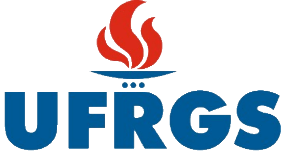

<p align="center">
  
</p>

<h1 align="center">FisiTexto</h1>

<p align="center">
  <b>Processador de texto</b><br>
  Alternativa livre ao <b>Microsoft Word</b>
</p>

<p align="center">
  Disponibilizado pelo <b>FisiLab — LARFIC · UFRGS</b> em parceria com o <b>CTA — Centro de
  Tecnologia Acadêmica</b>, para estudantes, professores e técnicos da UFRGS.
</p>

---

## O que faz

- **Interface familiar:** faixa de opções com as guias, grupos e atalhos que quem usa o Word já
  conhece; a galeria de estilos mostra a prévia ao vivo.
- **Seus arquivos:** abre e salva `.docx`, e também `.odt`, `.rtf`, `.html`, `.md`, `.tex` e
  `.txt`; importa documentos `.doc` do Word 97-2003; exporta PDF com texto selecionável, links e
  marcadores.
- **Formatação completa:** fontes, parágrafos, estilos, listas, tabelas (mesclar, dividir,
  estilos, fórmulas), colunas, quebras de seção, cabeçalhos e rodapés, numeração de páginas, marca
  d'água e bordas de página.
- **Trabalho acadêmico:** sumário, notas de rodapé e de fim, citações e bibliografia (APA, MLA,
  Chicago, IEEE), legendas, referências cruzadas e índice remissivo.
- **Revisão:** ortografia e gramática enquanto você digita, comentários nas margens, controle de
  alterações (aceitar e rejeitar), comparação de documentos e verificador de acessibilidade.
- **Mala direta:** a partir de um CSV, com campos, bloco de endereço, envelopes e etiquetas.
- **Privado e rápido:** tudo funciona sem internet; o texto é diagramado em Rust nativo, na GPU.
- **Automação:** cada ação é um comando, disponível pela linha de comando (`fisitexto-cli`), por
  um canal de controle JSON e por um servidor MCP para agentes de IA.

A interface abre em português do Brasil e pode ser trocada em Arquivo › Opções. Os temas
**UFRGS Noite** (padrão) e **UFRGS Dia** usam as cores da Suíte FisiLab; os temas originais
continuam disponíveis.

## Instalação

### Windows

Baixe o instalador `FisiTexto-Setup-<versão>.exe` no portal de downloads da Suíte FisiLab ou na
página de [Releases do `mrcandrade/fisitexto`](https://github.com/mrcandrade/fisitexto/releases)
e execute-o.

### Compilar a partir do código

É preciso ter o [Rust](https://www.rust-lang.org/pt-BR/tools/install) instalado.

```sh
git clone https://github.com/mrcandrade/fisitexto
cd fisitexto
cargo run --release -p wordcraft                  # o aplicativo (fisitexto.exe)
cargo run --release -p wordcraft -- --sample      # com o documento de exemplo
cargo run --release -p wordcraft-cli -- --help    # a linha de comando (fisitexto-cli.exe)
```

Os executáveis ficam em `target/release/` (`fisitexto` e `fisitexto-cli`).

## Créditos

O FisiTexto é uma versão modificada do [WordCraft](https://github.com/storytold/wordcraft), criado
pelo ArtCraft Team e contribuidores. Todo o trabalho de edição, formatos de arquivo e ferramentas
vem do projeto original; o FisiLab alterou o nome, a identidade visual, o tema de cores, a tela de
abertura, os links e o empacotamento (veja [MODIFICACOES.md](MODIFICACOES.md)).

Licença: [MIT](LICENSE-MIT) ou [Apache-2.0](LICENSE-APACHE), à sua escolha. Os avisos exigidos
estão em [NOTICE](NOTICE), os materiais de terceiros em [ATTRIBUTION.md](ATTRIBUTION.md) e o
README original em [README.upstream.md](README.upstream.md).

Os nomes e marcas do projeto original pertencem aos seus titulares; esta versão não é afiliada nem
endossada por eles. Microsoft e Microsoft Word são marcas da Microsoft Corporation, citadas apenas
para descrever a compatibilidade.

## Manifesto

Conhecimento produzido em uma universidade pública deve circular livremente — e as ferramentas que
usamos para ensinar, pesquisar e criar também.
Leia o [Manifesto pelas tecnologias livres](https://github.com/mrcandrade/larfic/blob/main/suite-fisilab/MANIFESTO.md).

---

<p align="center">
  <a href="https://www.ufrgs.br"></a>
  &nbsp;&nbsp;&nbsp;
  <a href="https://cta.if.ufrgs.br"></a>
  &nbsp;&nbsp;&nbsp;
  <a href="https://github.com/mrcandrade/larfic/tree/main/suite-fisilab"></a>
  <br>
  <sub>Suíte FisiLab · FisiLab — LARFIC · UFRGS · em parceria com o CTA — Centro de Tecnologia Acadêmica</sub>
</p>
